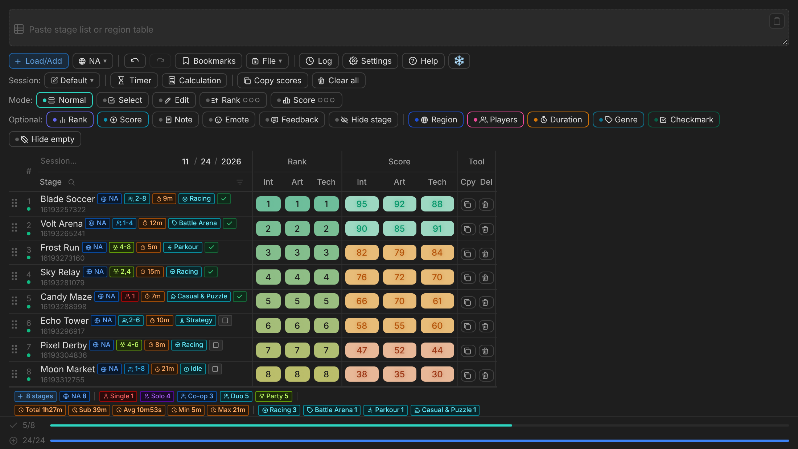

# Snomnom Rank Tool

**Rank, score and organize game stages in one page.**

[**Open the tool**](https://snommellow.github.io/snomnom-organizer-/)

---

## What it does

Paste a list of stages, then rank them, score them and keep notes on each one.
Everything runs in your browser from a single HTML file. Nothing to install, no account,
and your work stays on your device.

## Quick start

1. Open the tool.
2. Paste stage names into the top box, one per line, and press **Load/Add**.
   A table copied from a sheet works too: a name, then its NA, EU, Asia and TW IDs.
3. Click a rank or score cell to fill it in.
4. Press **Copy scores** to paste the results back into your sheet.

## Features

### Ranking and scoring
- Modes: **Normal**, **Select**, **Edit**, **Rank** and **Score**
- Grades with rank ranges, a max rank, and auto-rank by score
- Strict progression, lock rank when typed, auto-hide overflow
- Average score column, progress bar and stats row

### Stage details
- Optional tags: Region, Players, Duration (with a stopwatch), Genre, Checkmark, Feedback, Note and Emote
- Custom genres, region IDs for NA, EU, Asia and TW/HK/MO
- Hide stages, hide empty tags, tags in their own column
- Search by name or ID, filters and multi-key sort

### Session tools
- **Timer** with a deadline
- **Calculation** for earn rules and a running counter
- **Bookmarks**: an Auto slot plus 50 saved slots, with auto-save
- Undo and redo

### Saving and sharing
- Copy scores straight into a spreadsheet
- Export JSON, TSV, PNG or PDF, with a preview first
- **Present** mode for a clean table view

### Make it yours
- 24 themes and 18 fonts
- 10 layouts, settings profiles and rebindable shortcuts
- Choose what left and right click do on each tag
- Drag toolbar buttons to rearrange them

## Your data

The tool saves to your browser's local storage. Clearing your browser data removes it,
so export a JSON backup now and then. **File > Import JSON** brings it back.

## Coming next

**Snomnom Organizer Tool 3.0** is in progress: a full redesign with new modes,
Scan, a Workspace, folders, translation and much more.
