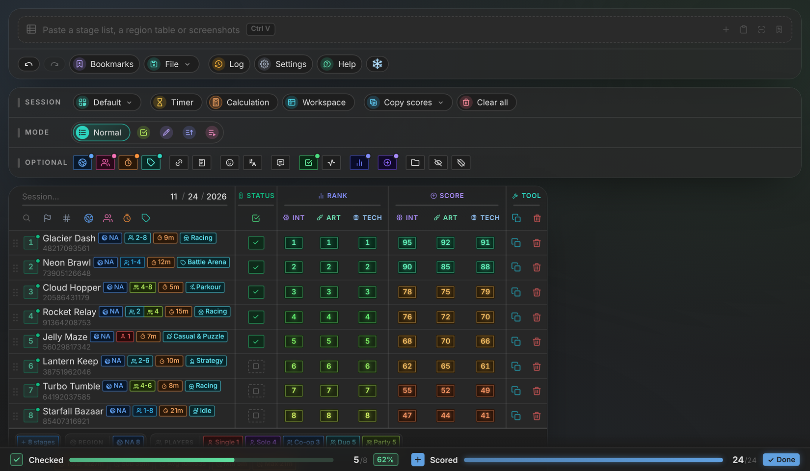
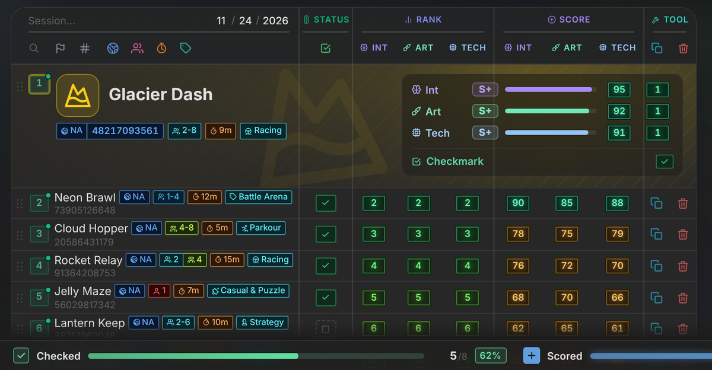
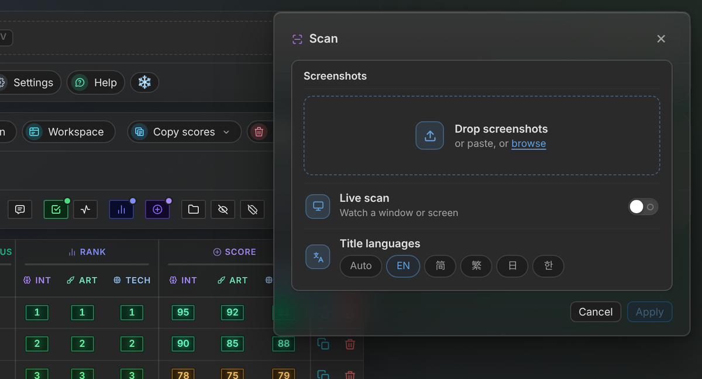
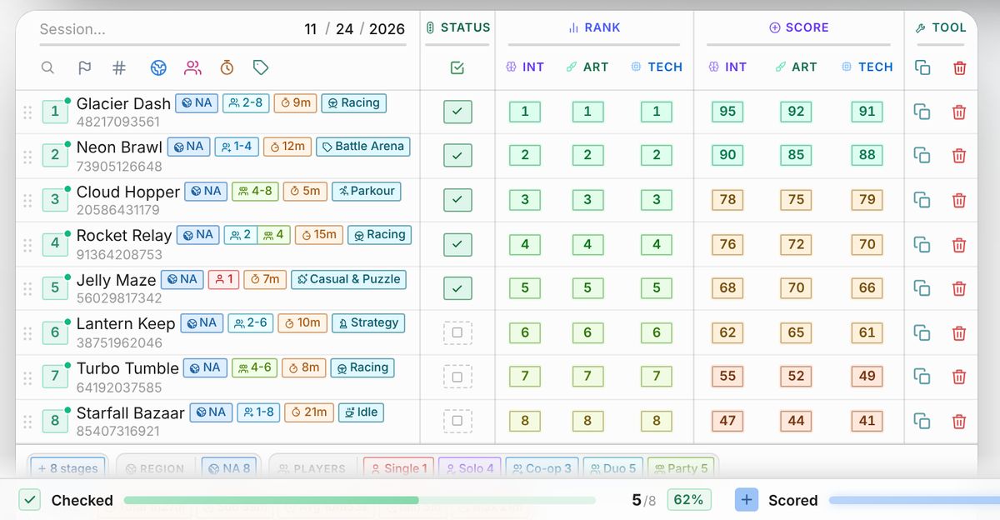

 

**[Open the tool](https://snommellow.github.io/snomnom-organizer-/)** &nbsp;·&nbsp;
[Highlights](#highlights) &nbsp;·&nbsp;
[Quick start](#quick-start) &nbsp;·&nbsp;
[Features](#features) &nbsp;·&nbsp;
[Shortcuts](#keyboard-shortcuts) &nbsp;·&nbsp;
[Your data](#your-data)

 

 

Paste a list of stages, then rank them, score them and keep everything about each one in one place.
The whole tool is a single HTML file that runs in your browser. There's nothing to install and no
account, and your work stays on your device.

 

## Highlights

<table>
  <tr>
    <td width="50%" valign="top">
      
      <h3>Order and Grade</h3>
      Rank one category at a time by dragging, or drop stages into grade lanes to score them.
    </td>
    <td width="50%" valign="top">
      
      <h3>Stage page</h3>
      Click a stage's number and it opens into a page with its tags, scores, note and cover.
    </td>
  </tr>
  <tr>
    <td width="50%" valign="top">
      
      <h3>Scan</h3>
      Drop screenshots of a stage's page. Scan reads the ID, players, time, genre, title and cover.
    </td>
    <td width="50%" valign="top">
      
      <h3>Workspace</h3>
      Apps that work on your table. Grade, Compare, Random pick and Session compare come built in.
    </td>
  </tr>
  <tr>
    <td width="50%" valign="top">
      
      <h3>Make it yours</h3>
      34 themes, 18 fonts, accent styles, colour scales and a custom pointer.
    </td>
    <td width="50%" valign="top">
      
      <h3>Light and dark</h3>
      17 dark themes and 17 light ones. Switch any time from Settings.
    </td>
  </tr>
</table>

 

## Quick start

1. **[Open the tool](https://snommellow.github.io/snomnom-organizer-/)**.
2. Paste stage names into the top box, one per line, and press **Add**.
   A table from a sheet works too: a name, then its NA, EU, Asia and TW IDs.
   You can also paste screenshots, and Scan will read them.
3. Click a rank or score cell to pick a value.
4. Turn on the details you need from the **Optional** row: region, players, duration, genre, notes and more.
5. Press **Copy scores** to paste the results back into your sheet.

If the page closes, your table is still there when you come back. Save it to a bookmark to keep a copy, or turn on Auto-save in Settings.

 

## Features

<b>Table and modes</b>

 

- Five modes: Normal, Select, Edit, Order and Playlist
- Edit works like a spreadsheet. Arrow keys move between cells, a pasted block fills across and down, and odd cells get flagged
- Playlist lines up today's stages with their goals. Press Play and work through them one by one
- Folders split the table into sections, each with its own colour, icon and progress bar
- Drag rows to reorder them and column headers to move columns
- Search, filter, and sort by as many keys as you need
- Undo works on everything, even Clear all. Right-click Undo to jump back several steps

<b>Getting stages in</b>

 

- Paste a list of names, or a table copied from a sheet with each region's ID
- Scan reads screenshots of a stage's page: ID, players, time, genre, title, description and cover
- Live scan watches a window and picks up new stage pages as you open them
- Recall finds stages you worked on in an older bookmark and brings that work back

<b>Stage details</b>

 

- Tags for region, players, duration, genre, checkmark and progress
- Links, notes and feedback, each in its own window. Notes and feedback have a formatting toolbar
- An English name next to each stage, from its brackets, an offline translation pack or an online search
- An emote for every stage, picked from its name, out of more than 1,000
- A cover picture per stage, uploaded or taken from Scan
- Hold a tag and slide to a choice to set it quickly

<b>Ranking and scoring</b>

 

- Up to 12 categories, each with its own Rank and Score column
- Grades with rank ranges you can drag to adjust
- Auto-rank by score, strict progression and a rank cap
- Duplicate ranks or scores if you want them, or rank and score kept independent
- Progress bars for checked and scored stages, and a stats row by region, players, genre and time

<b>Session tools</b>

 

- Timer: set a length or count down to a time
- Calculation: earn rules and rule sets, with starter rules to build from
- Workspace: apps that work on your table (Grade, Compare, Random pick, Session compare), and you can add your own

<b>Saving and sharing</b>

 

- Bookmarks: 50 slots of your own, plus an Auto slot that keeps itself current when Auto-save is on
- Copy scores, ranks, names, IDs or notes, ready to paste into a sheet
- Export JSON, TSV, PNG or PDF, with a preview first
- Present mode for a clean view of the table
- Share settings, layouts and Calculation rules as a code
- Back up everything in one file, or keep a synced copy in Google Drive, OneDrive, Dropbox or iCloud

<b>Make it yours</b>

 

- 34 themes, half dark and half light, with optional theme personality
- 18 fonts, accent styles and colour scales
- 10 ready-made layouts, your own custom one, and settings profiles
- Choose what left and right clicks do across the table
- Drag toolbar buttons to rearrange them
- Rebind any keyboard shortcut, or use touch gestures on phones and tablets

 

## Keyboard shortcuts

| Action | Keys | | Action | Keys |
|---|---|---|---|---|
| Undo | `Ctrl` `Z` | | Normal mode | `Esc` |
| Redo | `Ctrl` `Shift` `Z` | | Select mode | `Alt` `S` |
| Copy all scores | `Ctrl` `Shift` `C` | | Edit mode | `Alt` `E` |
| Copy row scores | `Alt` `C` | | Playlist mode | `Alt` `P` |
| Next unfilled score | `Alt` `N` | | Order: next category | `Alt` `R` |
| Toggle checkmark | `Alt` `K` | | Grade: next category | `Alt` `G` |
| Search stages | `Alt` `F` | | Open bookmarks | `Alt` `B` |
| Open settings | `Ctrl` `,` | | Note window | `Alt` `Shift` `N` |

You can change any of them in Settings > Shortcuts.

 

## Your data

Everything saves in your browser on this device. Nothing is uploaded unless you turn on the online lookups, and those send only a stage's name.

- Bookmarks keep copies of your table to come back to.
- Settings > Data > Backup downloads everything in one file, for moving to another browser.
- Settings > Data > Data file keeps a synced copy in a cloud folder. The browser stays the main copy.

Clearing your browser data removes what's saved, so keep a backup.

 

## Versions

| Version | Notes |
|---|---|
| [**3.0**](https://github.com/snommellow/snomnom-organizer-/releases/tag/v3.0) | Snomnom Organizer Tool. A full redesign from scratch with new modes, Scan, Workspace, Folders, translation and more. |
| [2.1](https://snommellow.github.io/snomnom-organizer-/v2.1.html) | Snomnom Rank Tool. Genre, Duration and Note tags, Timer, Calculation, Bookmarks, profiles and layouts. |
| [2.0](https://snommellow.github.io/snomnom-organizer-/v2.0.html) | Snomnom Rank Tool. Rebuilt from the spreadsheet as a single HTML file. |
| 1.x | The original Excel spreadsheet. |

 

## License

Released under the [MIT License](LICENSE).

 

Made by <a href="https://github.com/snommellow">snommellow</a>

