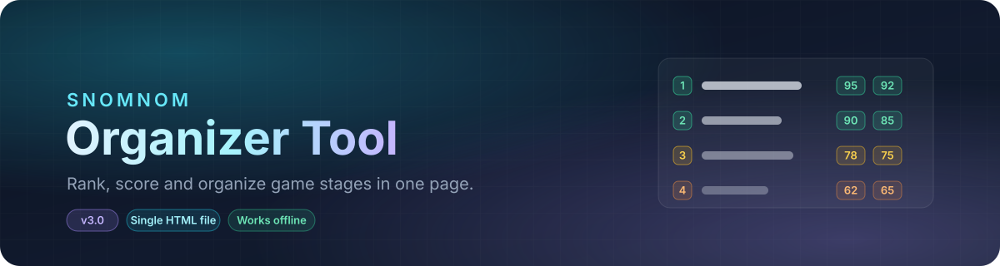
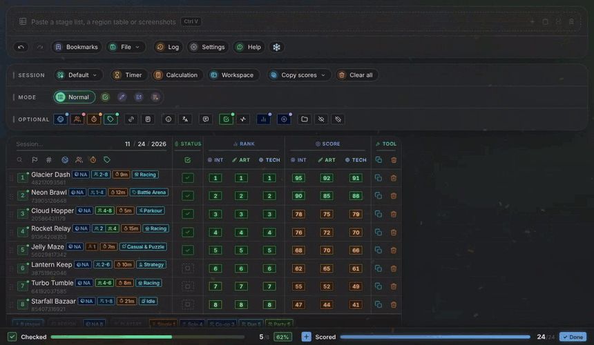
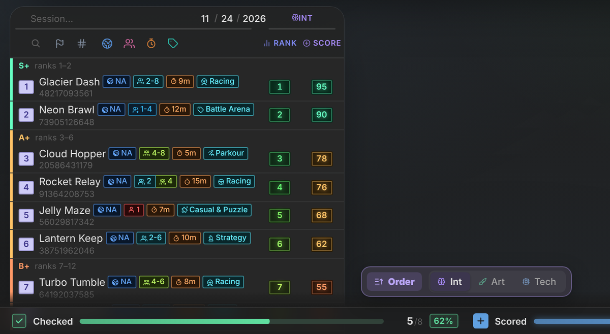
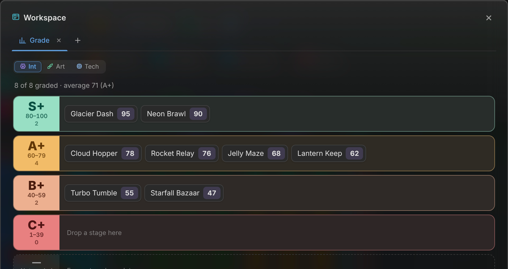
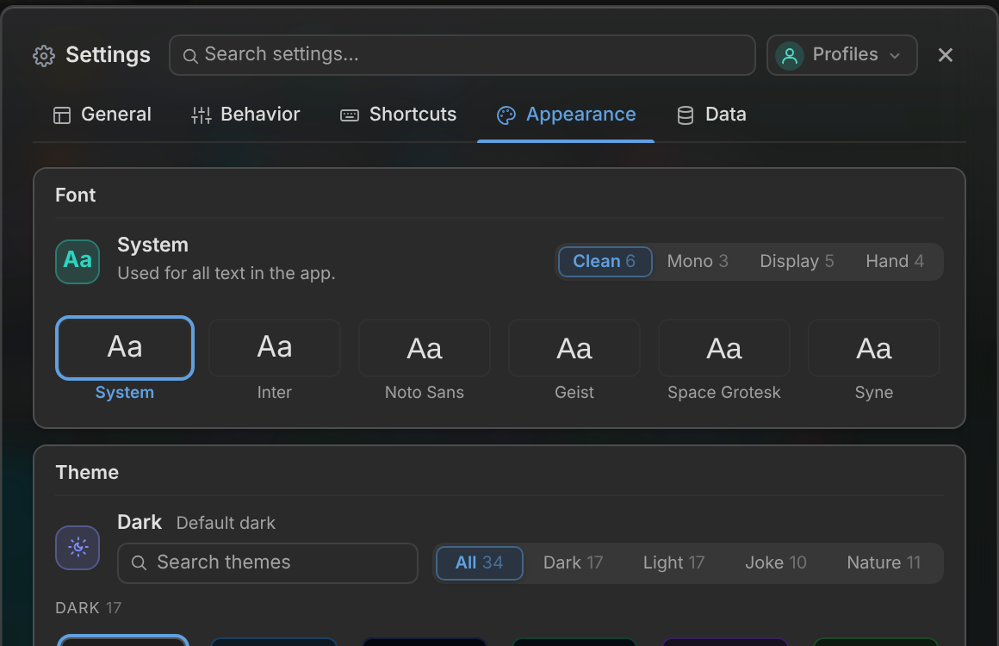

 

**[Open the tool](https://snommellow.github.io/snomnom-organizer-/)** &nbsp;·&nbsp;
[Highlights](#highlights) &nbsp;·&nbsp;
[Quick start](#quick-start) &nbsp;·&nbsp;
[Features](#what-else-it-does) &nbsp;·&nbsp;
[Shortcuts](#keyboard-shortcuts) &nbsp;·&nbsp;
[Your data](#your-data)

 

 

I made this to keep track of stages in games that have them, like sandbox games where players build
and share their own. Paste in a list of stages, rank them, score them, and keep notes and details on
each one in one place.

It's a single HTML file that runs in your browser, so there's nothing to install and no account, and
your work stays on your device.

 

## Highlights

<table>
  <tr>
    <td width="50%" valign="top">
      
      <h3>Order and Grade</h3>
      Rank one category at a time by dragging, or drop stages into grade lanes to score them.
    </td>
    <td width="50%" valign="top">
      
      <h3>Stage page</h3>
      Click a stage's number and it opens into a page with its tags, scores, note and cover.
    </td>
  </tr>
  <tr>
    <td width="50%" valign="top">
      
      <h3>Scan</h3>
      Drop screenshots of a stage's page. Scan reads the ID, players, time, genre, title and cover.
    </td>
    <td width="50%" valign="top">
      
      <h3>Workspace</h3>
      Small apps that run on your table: Grade, Compare, Random pick and Session compare.
    </td>
  </tr>
  <tr>
    <td width="50%" valign="top">
      
      <h3>Themes and fonts</h3>
      34 themes, 18 fonts, accent styles, colour scales and a custom pointer.
    </td>
    <td width="50%" valign="top">
      
      <h3>Light and dark</h3>
      Half the themes are light. This is the plain Light one.
    </td>
  </tr>
</table>

 

## Quick start

1. **[Open the tool](https://snommellow.github.io/snomnom-organizer-/)**.
2. Paste stage names into the top box, one per line, and press **Add**.
   A table from a sheet works too: a name, then its NA, EU, Asia and TW IDs.
   You can also paste screenshots, and Scan will read them.
3. Click a rank or score cell to pick a value.
4. Turn on the details you need from the **Optional** row: region, players, duration, genre, notes and more.
5. Press **Copy scores** to paste the results back into your sheet.

If the page closes, your table is still there when you come back. Save it to a bookmark to keep a copy, or turn on Auto-save in Settings.

 

## What else it does

- Five modes: Normal, Select, Edit, Order and Playlist. Edit works like a spreadsheet, with arrow keys and paste-to-fill
- Folders to split a long table into sections
- Up to 12 categories, each with its own rank and score column, and grade ranges you can drag
- Tags for region, players, duration, genre, checkmark and progress, plus links, notes and feedback
- English names for stages in other languages, from brackets, a translation pack or an online lookup
- Recall, which pulls past work on a stage back out of an older bookmark
- Timer, Calculation (earn rules), and Workspace apps like Grade, Compare and Random pick
- 50 bookmark slots, exports to JSON, TSV, PNG and PDF, and a Present view
- 34 themes and 18 fonts, rebindable shortcuts, and touch gestures on phones

The [changelog](CHANGELOG.md) has the full list.

 

## Keyboard shortcuts

| Action | Keys | | Action | Keys |
|---|---|---|---|---|
| Undo | `Ctrl` `Z` | | Normal mode | `Esc` |
| Redo | `Ctrl` `Shift` `Z` | | Select mode | `Alt` `S` |
| Copy all scores | `Ctrl` `Shift` `C` | | Edit mode | `Alt` `E` |
| Copy row scores | `Alt` `C` | | Playlist mode | `Alt` `P` |
| Next unfilled score | `Alt` `N` | | Order: next category | `Alt` `R` |
| Toggle checkmark | `Alt` `K` | | Grade: next category | `Alt` `G` |
| Search stages | `Alt` `F` | | Open bookmarks | `Alt` `B` |
| Open settings | `Ctrl` `,` | | Note window | `Alt` `Shift` `N` |

On a Mac, use Option for Alt and Cmd for Ctrl. You can change any of them in Settings > Shortcuts.

 

## Your data

Everything saves in your browser on this device. Nothing is uploaded unless you turn on the online lookups, and those send only a stage's name.

- Bookmarks keep copies of your table to come back to.
- Settings > Data > Backup downloads everything in one file, for moving to another browser.
- Settings > Data > Data file keeps a synced copy in a cloud folder. The browser stays the main copy.

Clearing your browser data removes what's saved, so keep a backup.

 

## Versions

| Version | Notes |
|---|---|
| [**3.0**](https://github.com/snommellow/snomnom-organizer-/releases/tag/v3.0) | Snomnom Organizer Tool. A full redesign from scratch with new modes, Scan, Workspace, Folders, translation and more. |
| [2.1](https://snommellow.github.io/snomnom-organizer-/v2.1.html) | Snomnom Rank Tool. Genre, Duration and Note tags, Timer, Calculation, Bookmarks, profiles and layouts. |
| [2.0](https://snommellow.github.io/snomnom-organizer-/v2.0.html) | Snomnom Rank Tool. Rebuilt from the spreadsheet as a single HTML file. |
| [1.2](versions/Snomnom_Rank_1.2.xlsx) | Excel. Checks moved under the grades, and the next stage to score is highlighted. |
| [1.1](versions/Snomnom_Rank_1.1.xlsx) | Excel. One check per category for duplicates, wrong grades, order and missing scores. |
| [1.0](versions/Snomnom_Rank_1.0.xlsx) | Excel. The original spreadsheet. Enter ranks and it fills in the grades, with a check on every row. |

 

## License

Released under the [MIT License](LICENSE).

 

Made by <a href="https://github.com/snommellow">snommellow</a>

